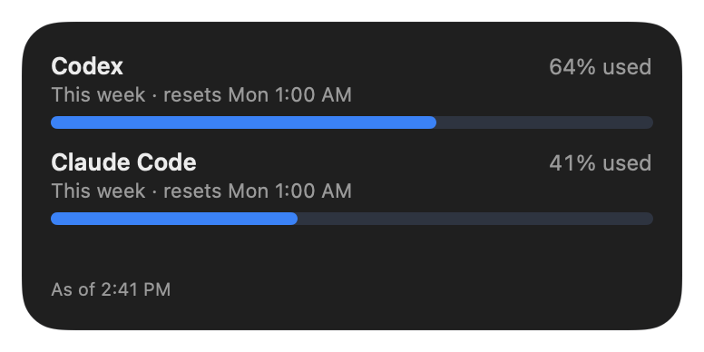
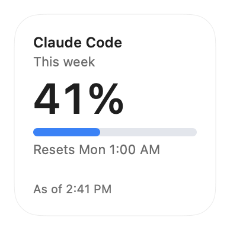
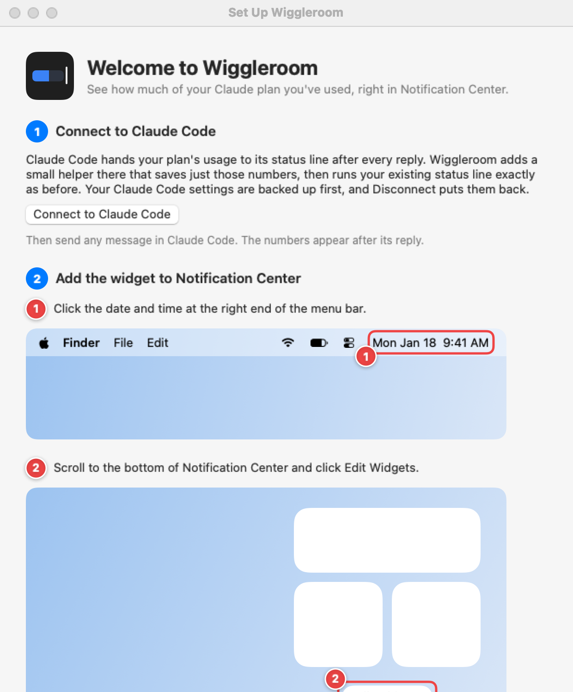

# Wiggleroom

**Every AI coding limit in one glance, in Mac Notification Center.** See how much of your Claude Code and Codex plans' weekly and 5-hour limits you've used, and when each one resets, without opening anything.

<p>
  
  
</p>

Wiggleroom is a free, open-source widget (plus an optional menu bar item) for people who use **Claude Code** on a Pro, Max or Ultra plan, **Codex** with a ChatGPT plan, or both. It shows the same numbers as each tool's own usage display.

- **No sign-in, no tokens, no internet.** Wiggleroom has no network code at all. It never reads your Claude or Codex login, the Keychain or browser cookies.
- **Keeps almost nothing.** Only the percent used, the reset times, the limit names and when they were updated, for each tool.
- **Leaves your setup alone.** Your existing Claude Code status line keeps working exactly as before, and Disconnect puts your settings back. Connecting Codex changes nothing in Codex.
- **Only official channels.** A tool is added only when it hands out its limits in a way its maker supports. See [which tools are supported and which are coming](docs/TOOLS.md).

[Website](https://garoknows.github.io/wiggleroom/) · [Download](https://github.com/garoknows/wiggleroom/releases) · [Install guide](docs/INSTALL.md) · [Tools](docs/TOOLS.md) · [Privacy](docs/PRIVACY.md)

## How it works

Every time Claude Code gets a reply, it hands a small bundle of information to its [status line](https://code.claude.com/docs/en/statusline), the optional line under the prompt. For Pro, Max and Ultra plans, that bundle includes your plan's usage: how much of the 5-hour and weekly limits you've used, and when each resets. This is a documented Claude Code feature.

When you click **Connect to Claude Code**, Wiggleroom adds a tiny helper to that status line. On each update the helper:

1. keeps only the usage numbers and the time (nothing else from the bundle),
2. saves them to a private file on your Mac,
3. runs your previous status line command, if you had one, with the same input, so what you see in Claude Code doesn't change.

The Wiggleroom app notices the new file, checks it, and passes it to the widget.

**Codex** works differently, because it has no status line command yet. After each reply, Codex writes a usage event into its own session log on your Mac. When you click **Connect** next to Codex in Settings, Wiggleroom starts watching that folder and, after each reply, reads only the usage numbers from the end of the newest log, read-only. Nothing in Codex changes, and nothing else from the log is kept. [More about how Codex is read](docs/TOOLS.md#how-wiggleroom-treats-codexs-log).

```
Claude Code ──(status line data)──> wiggleroom-statusline ──> your usual status line (unchanged)
                                         │
                                         └─ percent used + reset times only
                                              └─> Wiggleroom app ──> widget and menu bar
```

## Install

1. Download `Wiggleroom-<version>.dmg` from [Releases](https://github.com/garoknows/wiggleroom/releases), open it, and drag Wiggleroom to Applications.
2. Open Wiggleroom from Applications. A setup window appears.
3. Click **Connect to Claude Code**, then send any message in Claude Code.
4. Add the widget: click the date and time in the menu bar, scroll down, click **Edit Widgets**, search for Wiggleroom, and click the green **+**.
5. Use Codex too? Open Wiggleroom's Settings, go to **Tools**, and click **Connect** next to Codex. Then right-click the widget, choose **Edit Widget**, and set **Tool** to **All tools** (or Codex).

<picture>
  <source media="(prefers-color-scheme: dark)" srcset="docs/images/window-setup-dark.png">
  
</picture>

The [install guide](docs/INSTALL.md) has pictures for each step. You need macOS 14 Sonoma or later.

You can also install it with Homebrew:

```sh
brew install --cask garoknows/tap/wiggleroom
```

### Tried the Headroom preview?

For one day this app was published as an unsigned preview called Headroom. It was renamed because another Mac app already uses that name. If you installed it: open Headroom, click **Disconnect** in its Settings, quit it, and move it to the Trash. Then install Wiggleroom as above. If you skip this, Wiggleroom still handles it: Connect replaces the Headroom entry in your status line setting and keeps your own status line, and **Delete All Wiggleroom Data** also clears the preview's old folder.

## Good to know

- **Numbers update when a tool replies.** Claude Code's numbers arrive with each Claude Code reply, and Codex's with each Codex reply. Using Claude on claude.ai, or Codex in the cloud, counts toward the same limits, but Wiggleroom sees it only at the tool's next reply on your Mac. The "As of" time shows how fresh the numbers are. It turns amber after 30 minutes, and the bars dim after 6 hours.
- **Reset times are always right,** because both tools report the exact moment each limit resets. After a reset, Wiggleroom says "Reset at 1:00 AM, waiting for new numbers" instead of guessing 0%. Percentages round up, so Wiggleroom never shows less than you've used.
- **Plans without a 5-hour limit** show only the weekly row.
- **Signed in with an API key** (not a Claude or ChatGPT plan)? The tool doesn't report plan limits then, so Wiggleroom says so instead of showing 0%.
- **Widget:** right-click it and choose **Edit Widget** to pick the **Tool**: Claude Code, Codex or All tools. The small size shows one weekly limit (with All tools, the tool with the highest weekly percent); the medium size shows both limits of one tool, or one weekly row per tool.
- **Alerts:** optional notifications when a tool passes 90% (or 75%) of a limit, at most once per level, per tool, per limit.
- **Menu bar:** optional, off by default. Shows the highest weekly percent of your tools, or the tool you pick in Settings. Hold the pointer over it to see which tool. Click it for every tool's limits: the menu bar's tool first, and in a compact view (each tool's weekly limit, plus any other limit at 75% or more) when you use both.
- **Status line note:** Claude Code shows fewer keyboard hints whenever any status line is set. If you had no status line before, connecting Wiggleroom adds an empty one, so you may notice those hints are gone.

## Uninstall

1. Open Wiggleroom's Settings and click **Disconnect** next to Claude Code (or **Delete All Wiggleroom Data**, which also disconnects). Your previous status line comes back. Codex needs nothing undone.
2. Click **Quit Wiggleroom** at the bottom of Settings, then drag Wiggleroom to the Trash.

If you delete the app without disconnecting, your previous status line keeps working: the setting Wiggleroom wrote runs it directly when Wiggleroom is gone. Disconnecting is still the tidy way, because it removes Wiggleroom's entry from your settings. Backups of your settings are in `~/Library/Application Support/io.github.garoknows.wiggleroom/settings-backups/`.

## Privacy

Wiggleroom stores a few small files of numbers: Claude Code's and Codex's in `~/Library/Application Support/io.github.garoknows.wiggleroom/` (readable only by you) and a copy in the app's shared container for the widget. It never connects to the internet, and it never writes anything in Codex's folder. See [docs/PRIVACY.md](docs/PRIVACY.md) for exactly what is stored and what is never touched.

## Build from source

You need Xcode 16 or later and [XcodeGen](https://github.com/yonaskolb/XcodeGen).

```sh
swift test --package-path Packages/WiggleroomCore   # tests
xcodegen generate                                  # makes Wiggleroom.xcodeproj from project.yml
open Wiggleroom.xcodeproj
```

Builds are signed "to run locally" by default. Unsigned builds can't share data with the widget (macOS only allows that for signed apps), so use the menu bar item, or copy `Config/Signing.example.xcconfig` to `Config/Signing.xcconfig` and add your Apple Developer Team ID.

## License and credits

[MIT](LICENSE). Wiggleroom is an independent project. It is not made by, affiliated with or endorsed by Anthropic or OpenAI. "Claude", "Claude Code" and "Codex" are used only to describe what Wiggleroom works with.
