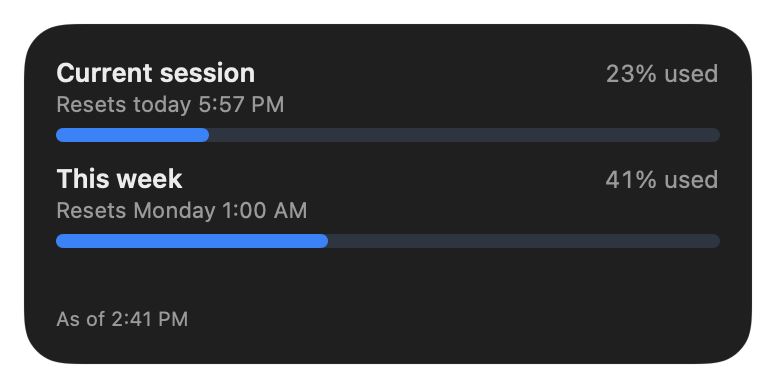

# Headroom

**Your Claude plan usage, in Mac Notification Center.** See how much of your weekly and 5-hour limits you've used, and when each one resets, without opening anything.

<p>
  
  
</p>

Headroom is a free, open-source widget (plus an optional menu bar item) for people who use **Claude Code** on a Pro, Max or Ultra plan. It shows the same numbers as the usage page in Claude's settings.

- **No sign-in, no tokens, no internet.** Headroom has no network code at all. It never reads your Claude login, the Keychain or browser cookies.
- **Keeps almost nothing.** Only the percent used, the reset times, the limit names and when they were updated.
- **Leaves your setup alone.** Your existing Claude Code status line keeps working exactly as before, and Disconnect puts your settings back.

[Website](https://garoknows.github.io/headroom/) · [Download](https://github.com/garoknows/headroom/releases) · [Install guide](docs/INSTALL.md) · [Privacy](docs/PRIVACY.md)

## How it works

Every time Claude Code gets a reply, it hands a small bundle of information to its [status line](https://code.claude.com/docs/en/statusline), the optional line under the prompt. For Pro, Max and Ultra plans, that bundle includes your plan's usage: how much of the 5-hour and weekly limits you've used, and when each resets. This is a documented Claude Code feature.

When you click **Connect to Claude Code**, Headroom adds a tiny helper to that status line. On each update the helper:

1. keeps only the usage numbers and the time (nothing else from the bundle),
2. saves them to a private file on your Mac,
3. runs your previous status line command, if you had one, with the same input, so what you see in Claude Code doesn't change.

The Headroom app notices the new file, checks it, and passes it to the widget.

```
Claude Code ──(status line data)──> headroom-statusline ──> your usual status line (unchanged)
                                         │
                                         └─ percent used + reset times only
                                              └─> Headroom app ──> widget and menu bar
```

## Install

1. Download `Headroom-<version>.dmg` from [Releases](https://github.com/garoknows/headroom/releases), open it, and drag Headroom to Applications.
2. Open Headroom from Applications. A setup window appears.
3. Click **Connect to Claude Code**, then send any message in Claude Code.
4. Add the widget: click the date and time in the menu bar, scroll down, click **Edit Widgets**, search for Headroom, and click the green **+**.

The [install guide](docs/INSTALL.md) has pictures for each step. You need macOS 14 Sonoma or later.

A Homebrew cask (`headroom-usage`) will follow once a signed release has been checked on real Macs. Note that `brew install --cask headroom` installs a different, unrelated app.

## Good to know

- **Numbers update when Claude Code replies.** Using Claude on claude.ai or in the Claude app counts toward the same limits, but Headroom sees it only at your next Claude Code reply. The "As of" time shows how fresh the numbers are. It turns amber after 30 minutes, and the bars dim after 6 hours.
- **Reset times are always right,** because Claude Code sends the exact moment each limit resets. After a reset, Headroom says "Reset at 1:00 AM, waiting for new numbers" instead of guessing 0%.
- **Plans without a 5-hour limit** show only the weekly row.
- **Signed in with an API key** (not a Claude plan)? Claude Code doesn't report plan limits then, so Headroom has nothing to show.
- **Alerts:** optional notifications when you pass 90% (or 75%) of your weekly limit, once per week each.
- **Menu bar:** optional, off by default. Shows your weekly percent; click for the full card.
- **Status line note:** Claude Code shows fewer keyboard hints whenever any status line is set. If you had no status line before, connecting Headroom adds an empty one, so you may notice those hints are gone.

## Uninstall

1. Open Headroom's Settings and click **Disconnect** (or **Delete All Headroom Data**, which also disconnects). Your previous status line comes back.
2. Click **Quit Headroom** at the bottom of Settings, then drag Headroom to the Trash.

If you delete the app without disconnecting, Claude Code's status line goes blank. To fix that, reinstall and disconnect, or restore the backup Headroom made next to your settings (`~/.claude/settings.json.headroom-backup-…`).

## Privacy

Headroom stores two small files: the numbers file in `~/Library/Application Support/io.github.garoknows.headroom/` (readable only by you) and a copy in the app's shared container for the widget. It never connects to the internet. See [docs/PRIVACY.md](docs/PRIVACY.md) for exactly what is stored and what is never touched.

## Build from source

You need Xcode 16 or later and [XcodeGen](https://github.com/yonaskolb/XcodeGen).

```sh
swift test --package-path Packages/HeadroomCore   # tests
xcodegen generate                                  # makes Headroom.xcodeproj from project.yml
open Headroom.xcodeproj
```

Builds are signed "to run locally" by default. Unsigned builds can't share data with the widget (macOS only allows that for signed apps), so use the menu bar item, or copy `Config/Signing.example.xcconfig` to `Config/Signing.xcconfig` and add your Apple Developer Team ID.

## License and credits

[MIT](LICENSE). Headroom is an independent project. It is not made by, affiliated with or endorsed by Anthropic. "Claude" and "Claude Code" are used only to describe what Headroom works with.
