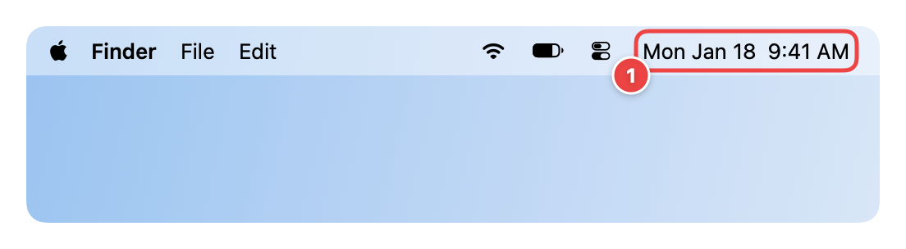
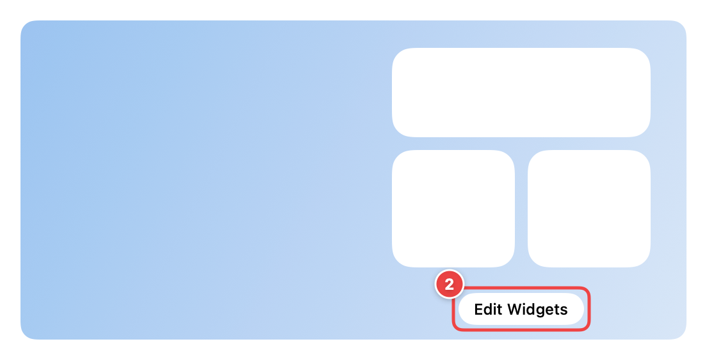
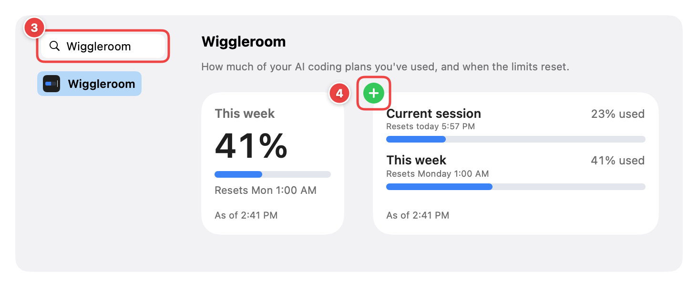

# Installing Headroom

You need a Mac with macOS 14 Sonoma or later, and Claude Code signed in with a Claude Pro, Max or Ultra plan.

## 1. Download and open

1. Go to [Releases](https://github.com/garoknows/headroom/releases) and download the newest `Headroom-<version>.dmg`.
2. Open the file and drag **Headroom** onto **Applications**.
3. Open **Headroom** from your Applications folder. (Opening it straight from the download window works too, but Headroom will ask you to move it to Applications before connecting, because Claude Code needs a place that won't move.)

Headroom has no Dock icon. It runs quietly in the background. To get back to it later, open it again from Applications: its Settings window appears.

## 2. Connect to Claude Code

In the setup window (or Settings), click **Connect to Claude Code**.

What this does: it adds Headroom's small helper to the `statusLine` setting in `~/.claude/settings.json`. It changes nothing else in that file, and saves a backup first, in Headroom's own private folder (`~/Library/Application Support/io.github.garoknows.headroom/settings-backups/`), not next to your settings, so a backup can never end up in a dotfiles repository. If you already had a status line, Headroom runs it after saving the numbers, so it looks exactly the same.

Then send any message in Claude Code. The numbers arrive with its reply.

## 3. Add the widget

**1.** Click the date and time at the right end of the menu bar. Notification Center opens.

**2.** Scroll to the bottom and click **Edit Widgets**.

**3.** Type **Headroom** in the search field.
**4.** Choose the small or medium size and click the green **+** (or drag the widget where you want it). Click **Done**.

You can also put the widget on your desktop: right-click the desktop, choose **Edit Widgets**, and drag it there.

## 4. Check the numbers

Compare the widget with **Settings > Usage** on claude.ai. They should match within a point. If the widget shows "Connect Headroom to Claude Code", send another message in Claude Code and wait a few seconds.

## Options

In Headroom's Settings:

- **Alerts:** a notification when you pass 90% of your weekly limit (and 75% if you turn it on). Once per week each.
- **Show in the menu bar:** your weekly percent next to a small gauge. Click it for the full card.
- **Open at login:** keeps the widget current after a restart. On by default after setup.
- **Reveal Data File** and **Delete All Headroom Data**.

## What the widget states mean

| You see | It means |
| --- | --- |
| "As of 2:41 PM" in grey | Numbers from Claude Code's last reply at 2:41 PM. |
| "As of" in amber | The numbers are over 30 minutes old. Usage elsewhere (claude.ai, the Claude app) isn't counted until your next Claude Code reply. |
| Dimmed bars | The numbers are over 6 hours old. |
| "Reset at 1:00 AM, waiting for new numbers" | That limit has reset; fresh numbers come with your next Claude Code reply. |
| "Connect Headroom to Claude Code" | No numbers yet. Connect, then send a message in Claude Code. |
| "This copy of Headroom can't share numbers with widgets" | You're running an unsigned build. Use the menu bar item, or install the signed release. |

## Uninstall

1. In Headroom's Settings, click **Disconnect** (your previous status line comes back), or **Delete All Headroom Data** (also disconnects).
2. Click **Quit Headroom** at the bottom of Settings, then drag Headroom to the Trash.

Using Homebrew? `brew uninstall --cask headroom-usage` removes the app (your previous status line keeps working even if you skip step 1), and `--zap` also removes Headroom's files.
